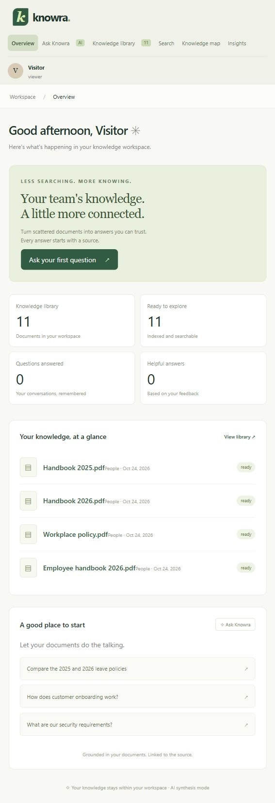
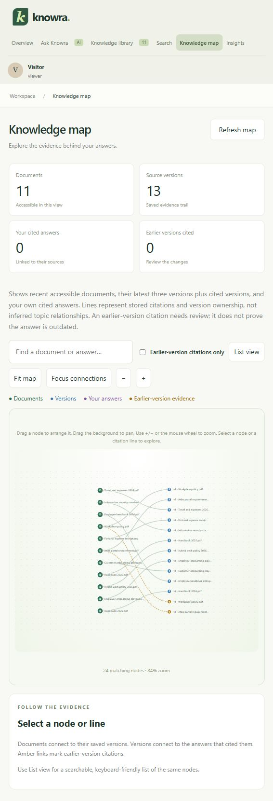

# Knowra

**Your company knowledge, connected.**

Find answers in documents, follow the supporting sources, and explore how information changes over time.

## Open Knowra

### [Launch the live app →](https://knowra-demo.onrender.com/)

Open the link to enter the dashboard directly. No sign-up or password is required.

## A look inside

Screenshots from the live public sample workspace.

| Workspace overview | Interactive Knowledge Map |
| --- | --- |
|  |  |

## What you can explore

- **Ask Knowra** — ask questions and open the document pages behind each answer.
- **Knowledge library** — browse the included policies, onboarding guides, and project requirements.
- **Version comparison** — see what changed between document versions.
- **Conflict reviews** — explore possible differences between policies and record your review.
- **Knowledge map** — discover connections between documents, topics, and answers.

## Try these questions

- “What is the remote-work policy?”
- “How many annual leave days are available?”
- “What changed in the Atlas requirements?”

The hosted experience includes fictional sample documents. Uploads and live OCR are unavailable in this version. Question limits apply, and the first visit may take a little longer while the free hosting wakes up.

## Try it locally

Prerequisites: Python 3.12 or later. Node.js 22 or later is needed only to rebuild the browser authentication bundle or work with Neon Functions.

```sh
git clone https://github.com/Shrutimaheta/knowra.git
cd knowra
python -m venv .venv
```

Activate the environment:

```sh
# macOS / Linux
source .venv/bin/activate
```

```powershell
# Windows PowerShell
.\.venv\Scripts\Activate.ps1
# If activation is blocked, use .venv\Scripts\python.exe in place of python.
```

Install and start:

```sh
python -m pip install -r apps/api/requirements.txt
python -c "from pathlib import Path; f=Path('.env').open('xb'); f.write(Path('.env.example').read_bytes()); f.close()"
python scripts/start.py
```

Open **http://127.0.0.1:8000**, create a workspace, and choose **Load sample data**. There are no committed user accounts or passwords. The default local profile uses SQLite, keyword retrieval and source excerpts; it needs no cloud account or paid API. The example-copy command refuses to overwrite an existing `.env`; keep your existing settings if it reports that the file exists.

For AI synthesis, set `LLM_PROVIDER=gemini` and your `GEMINI_API_KEY` privately in `.env`, choose a model available to your account, and restart. Retrieved passages and bounded conversation context are sent to the configured provider. Only use documents approved for that destination. Provider quotas and model availability apply.

For optional local semantic retrieval:

```sh
python -m pip install -r apps/api/requirements-semantic.txt
```

Set `EMBEDDING_MODEL=sentence-transformers/all-MiniLM-L6-v2` and temporarily `EMBEDDING_ALLOW_DOWNLOAD=true` for the first download. Then disable downloads. Index or reindex documents after enabling the model. Local embeddings use a 384-dimensional English-focused model; keyword search remains the lightweight default.

## Accounts and login

The full application includes workspace registration, email/password login, logout, password changes and recovery, invitations, and role-based access. Passwords are hashed with Argon2, and authentication uses expiring, revocable sessions in HttpOnly cookies. Enable secure cookies and HTTPS for deployment.

For the default local setup, keep `APP_ENV=development` and `AUTH_PROVIDER=local`, then create your own account in the browser. No shared username or password is included in the repository. Optional managed authentication is documented in the [Neon integration guide](docs/neon.md).

The public hosted experience opens directly with isolated visitor sessions. It intentionally does not show the full application's registration and login screens.

## Development and checks

```sh
python -m pip install -r apps/api/requirements-dev.txt
npm ci
npm run build
python -m ruff check apps/api/app apps/api/tests apps/api/migrations scripts
python -m pytest -q
```

CI defines SQLite, PostgreSQL/pgvector, container/parser/scanner/backup, and optional semantic-retrieval verification. Local checks do not establish that all hosted CI jobs have passed. Use the Actions results for the published commit as the release evidence.

```text
apps/api/app/         FastAPI backend and static frontend
apps/api/migrations/  Versioned database migrations
apps/api/tests/       Application and integration tests
web/                 Neon browser client bundle source
scripts/             Build, startup, evaluation and operations tools
infrastructure/      Proxy, backup and monitoring configuration
docs/                Architecture, deployment and demo guides
evals/               Fictional retrieval evaluation fixtures
render.yaml          Free demo deployment blueprint
neon.ts / hello.ts   Optional Neon services and integrity Function
```

## Deployment and security

See the [deployment guide](docs/deployment.md), [hosted setup](docs/render-demo.md), [contribution guide](CONTRIBUTING.md), and [security policy](SECURITY.md).

Keep API keys, database credentials, uploaded documents, and backups private. Copy `.env.example` for local settings and never commit your `.env` file. The full application and the hosted visitor experience have different capabilities; see the [hosting limits](docs/hosted-demo.md).

## License

Licensed under the [MIT License](LICENSE). You may use, modify, and redistribute the code, including commercially, provided you retain the copyright and license notice. The software is supplied without warranty. Third-party dependencies retain their own licenses.
