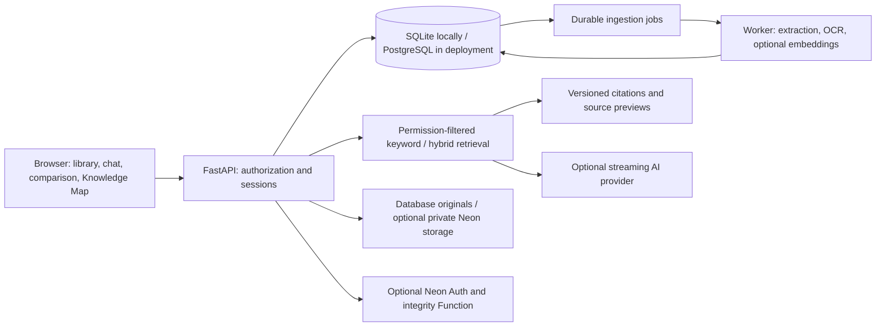

# Knowra

**Versioned knowledge, answers with sources, and an interactive view of what changed.**

Knowra helps teams explore documents, ask questions with citations, compare immutable versions, and review possible policy conflicts. A source inspector links answers back to the document version and page that supported them.

> The full application and the free hosted demo have different capabilities. The Render demo uses fictional documents and disables uploads, live OCR, and local semantic inference. Try the [live demo](https://knowra-demo.onrender.com) directly on the dashboard, without signing in. See [hosted verification and limits](docs/hosted-demo.md).

## What you can do

- **Ask with evidence:** stream answers with page and version references; use labelled source excerpts without an AI API key.
- **Inspect original sources:** open PDFs, image previews and highlighted evidence behind citations.
- **Track changes:** compare document versions and keep historical citation links tied to immutable sources.
- **Review potential conflicts:** inspect candidate policy conflicts and record review decisions. Candidate detection still needs human judgment.
- **Explore the Knowledge Map:** interact with document, topic and answer connections.
- **Ingest documents:** process PDF, TXT, Markdown, CSV, PNG, JPEG and WebP files, with bounded OCR for scanned pages and images.
- **Keep workspaces separate:** enforce tenant, role and document permissions before retrieval and source access.
- **Recover processing:** use durable ingestion jobs with leases, retries and visible failures.

## Try it locally

Prerequisites: Python 3.12 or later. Node.js 22 or later is needed only to rebuild the browser authentication bundle or work with Neon Functions.

```sh
git clone https://github.com/Shrutimaheta/knowra.git
cd knowra
python -m venv .venv
```

Activate the environment:

```sh
# macOS / Linux
source .venv/bin/activate
```

```powershell
# Windows PowerShell
.\.venv\Scripts\Activate.ps1
# If activation is blocked, use .venv\Scripts\python.exe in place of python.
```

Install and start:

```sh
python -m pip install -r apps/api/requirements.txt
python -c "from pathlib import Path; f=Path('.env').open('xb'); f.write(Path('.env.example').read_bytes()); f.close()"
python scripts/start.py
```

Open **http://127.0.0.1:8000**, create a workspace, and choose **Load sample data**. There are no committed user accounts or passwords. The default local profile uses SQLite, keyword retrieval and source excerpts; it needs no cloud account or paid API. The example-copy command refuses to overwrite an existing `.env`; keep your existing settings if it reports that the file exists.

For AI synthesis, set `LLM_PROVIDER=gemini` and your `GEMINI_API_KEY` privately in `.env`, choose a model available to your account, and restart. Retrieved passages and bounded conversation context are sent to the configured provider. Only use documents approved for that destination. Provider quotas and model availability apply.

For optional local semantic retrieval:

```sh
python -m pip install -r apps/api/requirements-semantic.txt
```

Set `EMBEDDING_MODEL=sentence-transformers/all-MiniLM-L6-v2` and temporarily `EMBEDDING_ALLOW_DOWNLOAD=true` for the first download. Then disable downloads. Index or reindex documents after enabling the model. Local embeddings use a 384-dimensional English-focused model; keyword search remains the lightweight default.

## Realistic fictional demo documents

Eight polished PDFs (24 pages) cover employee policies, hybrid work, expenses, security, employee/customer onboarding and an Atlas requirements change. **Load sample data** imports them, preserving the two Atlas baselines as versions of one document. See the [document guide and question flow](docs/demo-documents.md). The corpus includes 20 source-page checks and explicit missing-evidence questions; it is not a general answer-accuracy benchmark.

## Architecture



The frontend uses HTML, CSS and JavaScript served by FastAPI. SQLAlchemy and Alembic manage persistence and migrations. PostgreSQL supports full-text search and pgvector; the local path uses SQLite. No Redis service is required for the durable job queue.

## Full app and hosted demo

| Capability | Full app | Render Free demo |
| --- | --- | --- |
| Document library, citations and source previews | Yes | Fictional fixtures |
| Version comparison, conflict reviews, Knowledge Map | Yes | Yes |
| AI synthesis | Optional provider key | Optional provider key; quotas apply |
| Uploads and live OCR | Yes | Disabled |
| Semantic embeddings | Optional local model | Disabled |
| Accounts | Local or optional Neon Auth | Isolated automatic visitor sessions |
| Originals | Database or optional private object storage | Demo database |

Deploy the repository's root `render.yaml` as a Blueprint: [Render demo instructions](docs/render-demo.md). Use a **new dedicated Neon database** for demo fixtures, never an existing workspace database. The blueprint requests one free web service and no paid database or worker. The actual hosting plan must still be checked before deploying. Free services can sleep; cold starts and AI quotas affect response time.

The full production topology is separate: [deployment guide](docs/deployment.md), [release checklist](docs/release-checklist.md). It includes a separate worker, restricted parser and upload scanning configuration. Container/runtime acceptance, independent monitoring, SMTP, backup retention and capacity testing are release requirements, not implied guarantees.

## Development and checks

```sh
python -m pip install -r apps/api/requirements-dev.txt
npm ci
npm run build
python -m ruff check apps/api/app apps/api/tests apps/api/migrations scripts
python -m pytest -q
```

CI defines SQLite, PostgreSQL/pgvector, container/parser/scanner/backup, and optional semantic-retrieval verification. Local checks do not establish that all hosted CI jobs have passed. Use the Actions results for the published commit as the release evidence.

```text
apps/api/app/         FastAPI backend and static frontend
apps/api/migrations/  Versioned database migrations
apps/api/tests/       Application and integration tests
web/                 Neon browser client bundle source
scripts/             Build, startup, evaluation and operations tools
infrastructure/      Proxy, backup and monitoring configuration
docs/                Architecture, deployment and demo guides
evals/               Fictional retrieval evaluation fixtures
render.yaml          Free demo deployment blueprint
neon.ts / hello.ts   Optional Neon services and integrity Function
```

## Security and limitations

Never commit `.env`, API keys, database URLs, uploaded documents, mail outboxes or backups. `.env.example` contains placeholders only. See [SECURITY.md](SECURITY.md) for reporting guidance and [CONTRIBUTING.md](CONTRIBUTING.md) for development conventions.

OCR quality depends on the input, and citation links do not prove every generated claim. Conflicts are review candidates. Illegible files, missing evidence, provider failures and exhausted quotas are explicit outcomes. Evaluate accuracy and capacity on your own corpus before relying on Knowra for consequential decisions.

Optional managed backend setup: [Neon integration](docs/neon.md). No account identifiers, credentials, local databases or private screenshots are part of this repository.
