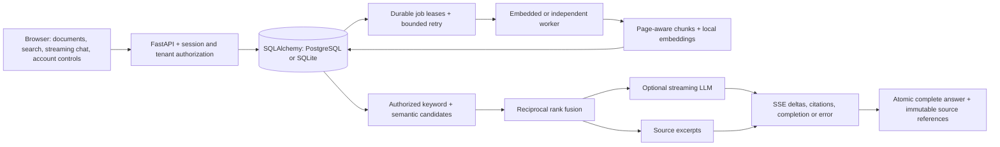

# Architecture

## Database and upgrades

SQLAlchemy manages transactions and portable parameter binding. Alembic revisions `0001`–`0006` create the baseline, add operational/security tables, and preserve legacy text and citations as immutable versions. Existing unversioned databases are stamped at the compatible baseline and then upgraded. Destructive downgrades are disabled. Back up before deploying migrations. PostgreSQL migration adds pgvector, a full-text GIN index and a cosine HNSW index for 384-dimensional embeddings. Operators need migration privileges to create the extension; the runtime role does not.

Original files, pages, checksum and version number live in `document_versions`. Chunks point at an immutable version. Only the document's current ready version enters retrieval. Previous versions remain readable through old citation links. Legacy PDF binaries were never saved by the old application; migration preserves the available extracted page text rather than inventing a replacement PDF.

## Worker reliability

An upload transaction creates the document, immutable version and queued job together. An atomic compare-and-update claims a job using an unpredictable lease token. Expired leases are reclaimable, with at most three automatic attempts and bounded backoff. Completed writes recheck the lease token and replace that version's chunk index atomically; stale workers cannot overwrite a new owner's work. Crashes before commit leave the queue intact. Crashes at the retry limit become visible failures. Manual retry is authorized and resets the retry budget.

Lease duration is 15 minutes. Keep processing within this budget; larger workloads should add lease heartbeats and an isolated parsing pool. Embedded mode is convenient for local use; the container topology runs an independent worker. The database itself is the durable queue, avoiding unnecessary Redis infrastructure.

## Retrieval

Only authorized current versions are eligible. SQLite performs local BM25-style ranking and cosine similarity. PostgreSQL narrows candidates using English full-text search and pgvector cosine distance under the same tenant/private predicates. Reciprocal rank fusion combines bounded keyword and semantic rankings. Embedding model names are stored per chunk so vectors from different models are not mixed. All configured models must produce 384 dimensions on the PostgreSQL path. The default MiniLM model is English-focused.

The local model is loaded from cache unless downloads are explicitly allowed. Inference is serialized per process with bounded Torch threads. A missing or broken configured model produces a retryable indexing error rather than silently labeling keyword results as semantic.

## Streaming and provenance

The SSE endpoint emits structured `citations`, `delta`, `done` and `error` events. Live provider output is streamed as received; excerpt mode emits the original passages without artificial delays. A per-conversation database lease prevents simultaneous generations. Interrupted output is visibly unsaved. Only a complete answer is committed with its user question, model, provider tokens and latency. Cancellation releases the conversation lease. Provider requests have connection/read limits, a total deadline and a bounded output budget.

Citations contain immutable version IDs, actual page numbers and preserved display indices. Source reads recheck document access. Deleting a document removes its source links from history; historical answer text remains the conversation owner's record. Password-reset and complete erasure policies are separate concerns.

Model citation indices are validated before save. Prompts instruct the model to treat documents as data, but prompts and index checks do not guarantee prompt-injection resistance or claim-level truth. Independent groundedness evaluation remains necessary before claiming those properties.

## Accounts and security

New passwords use Argon2id; legacy scrypt passwords transparently rehash after successful login. Sessions and one-use invitation/recovery tokens are random and stored only as hashes. Reset and password change revoke sessions. Reset tokens last 30 minutes and invitations 24 hours, and token consumption is transactional. New invitees choose their own password; production disables the old direct account-creation endpoint.

Development mail goes to a private local outbox, never to an unauthenticated token-return API. Production requires SMTP for delivery and has no development outbox fallback. Invitation issuance and mail delivery are synchronous; a production transactional mail outbox would improve delivery reconciliation after a crash between sending mail and committing the transaction.

The API uses server-derived tenant/user scope, parameterized queries, escaped UI text, HttpOnly/SameSite cookies, exact configured-origin checks, shared database rate limits, quotas and CSP. Production requires HTTPS and secure cookies at startup. Interactive Swagger docs are development-only and use their own CDN-compatible CSP; the application itself keeps a strict self-only script policy. Database exception logs hide SQL parameter values. Request logs omit bodies and query strings.

PDF validation happens in the API; OCR and layout extraction run in the durable ingestion worker. MuPDF and OCR access are serialized within each process. Version metadata records page extraction methods, tables and notices; derived pages/chunks are committed atomically. Source page rendering and optional one-page visual questions recheck document authorization. Hostile upload deployments need antivirus scanning, parser process isolation, CPU/memory limits and potentially presigned object storage. Database rate limits bound admitted requests but do not replace edge-level abuse prevention.

## Verification boundaries

Automated tests cover account and permission boundaries, immutable originals/citations, reset replay and expiry, session revocation, invitation roles, crashed/retried jobs, shared limits, quotas, successful and interrupted SSE, legacy migration and backup/restore. The provider wire protocol is regression-tested with simulated streams. Gemini streaming synthesis was additionally verified against the live API using fictional policy evidence.

The six-question retrieval evaluation uses actual local MiniLM embeddings and measures retrieval only. The local HTTP smoke load exercises 50 keyword searches against four fictional documents. Neither result is a production benchmark. PostgreSQL/pgvector and container jobs are supplied in CI; they have not been executed on this Docker-less computer. Public deployment and live SMTP/provider validation require the operator's configuration.

Conflict reviews are derived from current, permission-checked source versions using bounded local policy checks. Review fingerprints bind both exact source passages and version IDs; decisions are keyed by user and fingerprint. A write locks the organization row also used by uploads, rechecks current versions and permissions, and rederives the finding before upserting. Reviews do not mutate source text or feed authority instructions into generation. Source deletion cascades saved reviews.

## Optional managed services

Revision 0006 adds managed identity bindings and external original-object keys and sizes. Neon storage can hold private originals while metadata stays in SQL. See [neon.md](neon.md) for opt-in configuration and known limits.
